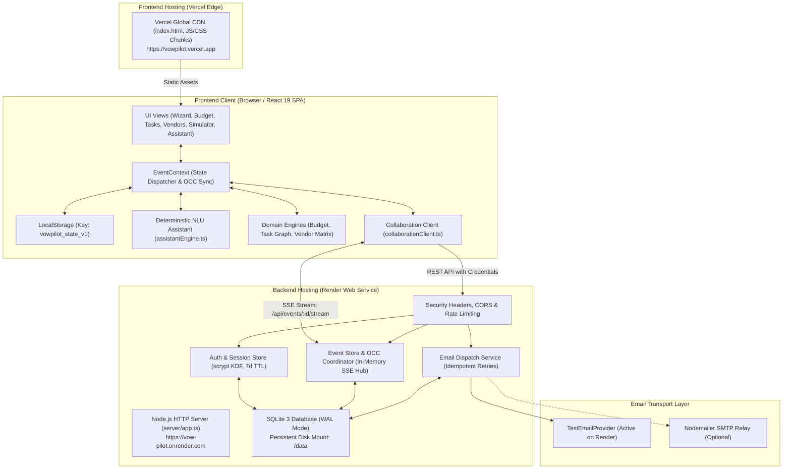

# VowPilot

> **Plan with clarity. Coordinate with confidence.**

VowPilot is an intelligent, deterministic celebration and event-planning system built for **Prompt Wars Virtual — Challenge 5: Celebration and Event Planner**.

Unlike generic conversational chatbots that hallucinate market prices, invent vendors, or struggle with multi-step financial arithmetic, VowPilot behaves like an experienced, highly disciplined event coordinator. It enforces verified budget and venue constraints, segregates cost commitments, detects dependency cycles in real-time schedules, models complex trade-offs in an interactive decision simulator, tracks live budget runway, and supports multi-user collaboration via Server-Sent Events (SSE) and Optimistic Concurrency Control (OCC).

---

## Deployments & Quick Links

* **Live Frontend:** [https://vowpilot.vercel.app/](https://vowpilot.vercel.app/) *(Hosted on Vercel Edge)*
* **Live Backend API:** [https://vow-pilot.onrender.com](https://vow-pilot.onrender.com/) *(Hosted on Render Web Service)*
* **Backend Health Check:** [https://vow-pilot.onrender.com/health](https://vow-pilot.onrender.com/health)
* **GitHub Repository:** [https://github.com/agnidiptasarkar123-dev/Vow-Pilot](https://github.com/agnidiptasarkar123-dev/Vow-Pilot)

---

## 1. Challenge & Chosen Vertical

* **Competition:** Prompt Wars Virtual — Challenge 5
* **Vertical:** Celebration & Event Planner
* **Target Domain:** Full-Lifecycle Event Planning, Budget Allocation, Supplier Quotation Auditing, Dependency Scheduling, Multi-User Collaboration, and Decision Impact Simulation.
* **Target Persona:** An individual, couple, or professional event planner organizing a milestone celebration (such as a 150–300 guest wedding, anniversary, or gala) with a hard financial ceiling, venue capacity constraints, fixed milestone deadlines, and diverse supplier contracts.

---

## 2. Problem Statement

Event planning is characterized by fragmented, interdependent decisions made under uncertainty:
1. **Isolated Decision-Making:** Adding 30 guests, upgrading a photographer, or shifting an event date causes cascading impacts across catering per-plate costs, sound curfew deadlines, prerequisite contracts, and overall contingency buffers.
2. **LLM Failure Modes in Event Planning:** Generic conversational AI models frequently hallucinate pricing estimates, make arithmetic errors when recalculating budgets, recommend contradictory timelines, and lack mechanisms to enforce data integrity or prevent unauthorized state changes.
3. **Collaboration Friction:** Multiple stakeholders (couples, parents, coordinators) often edit plans simultaneously without version control, leading to accidental overwrites and out-of-sync financial commitments.

VowPilot solves these problems by anchoring every planning calculation, schedule validation, and assistant response to an authoritative, verifiable domain model with strict concurrency controls.

---

## 3. Solution & Differentiators

* **Deterministic Domain Logic over Probabilistic Guessing:** All budget calculations, guest scaling, graph cycle detections, and deadline verifications are executed by pure mathematical domain engines using integer minor currency units (paise/cents).
* **Dual-Mode Architectural Resilience:** Operates out of the box as a fully functional **Local-First** browser application (using `localStorage` with corrupted-state recovery), while seamlessly connecting to an authenticated Node.js/SQLite backend for real-time multi-user collaboration.
* **Human-in-the-Loop Action Safeguards:** The planning assistant never mutates event state autonomously. Consequential changes (e.g., updating guest count or rebalancing budgets) produce a structured **Action Proposal Card** with a financial variance preview that requires explicit user confirmation.
* **Graph-Based Dependency Engine:** Schedules are modeled as directed acyclic graphs (DAGs). A Depth-First Search (DFS) algorithm actively prevents circular blockers and enforces that prerequisite tasks are completed before downstream tasks can be finished.
* **Non-Destructive Decision Simulator:** A dedicated sandbox allows organizers to test alternative scenarios without modifying baseline data.

---

## 4. Feature List with Verified Implementation Status

| Feature | Verified Status | Implementation Location | API / DB Interaction | Primary Capabilities |
| :--- | :--- | :--- | :--- | :--- |
| **Needs Assessment Wizard** | **Implemented** | [`src/components/assessment/NeedsAssessmentWizard.tsx`](file:///Users/agnidiptasarkar/Desktop/virtual/src/components/assessment/NeedsAssessmentWizard.tsx) | Local state / `POST /api/events` | 5-step guided onboarding, field validation, capacity warnings, initial milestone generation. |
| **Budget & Runway Engine** | **Implemented** | [`src/domain/budgetEngine.ts`](file:///Users/agnidiptasarkar/Desktop/virtual/src/domain/budgetEngine.ts), [`src/domain/currency.ts`](file:///Users/agnidiptasarkar/Desktop/virtual/src/domain/currency.ts) | SQLite `event_expenses` table | Strict cost segregation (`estimated`, `quoted`, `confirmed`, `actual`), integer minor units, guest scaling, priority cuts. |
| **Dependency Task Graph** | **Implemented** | [`src/domain/taskEngine.ts`](file:///Users/agnidiptasarkar/Desktop/virtual/src/domain/taskEngine.ts), [`src/components/tasks/TaskManagementView.tsx`](file:///Users/agnidiptasarkar/Desktop/virtual/src/components/tasks/TaskManagementView.tsx) | SQLite `event_tasks` table | DFS cycle detection, prerequisite blocking rule, deadline realism checks, cascading delay risk analysis. |
| **Vendor Quotation Matrix** | **Implemented** | [`src/domain/vendorEngine.ts`](file:///Users/agnidiptasarkar/Desktop/virtual/src/domain/vendorEngine.ts), [`src/components/vendors/VendorCoordinationView.tsx`](file:///Users/agnidiptasarkar/Desktop/virtual/src/components/vendors/VendorCoordinationView.tsx) | SQLite `event_vendors` table | Side-by-side comparison against category averages, missing terms detection, clarification inquiry generator. |
| **Decision Impact Simulator** | **Implemented** | [`src/components/simulator/DecisionSimulatorView.tsx`](file:///Users/agnidiptasarkar/Desktop/virtual/src/components/simulator/DecisionSimulatorView.tsx) | Sandboxed in-memory state | Non-destructive what-if modeling, dynamic guest slider, delta variance analysis, named scenario comparison. |
| **Multilingual NLU Assistant** | **Implemented** | [`src/domain/assistantEngine.ts`](file:///Users/agnidiptasarkar/Desktop/virtual/src/domain/assistantEngine.ts), [`src/domain/assistantValidation.ts`](file:///Users/agnidiptasarkar/Desktop/virtual/src/domain/assistantValidation.ts) | In-memory evaluation | Multilingual intent parsing (English, Bengali Unicode, Romanized Benglish), security filtering, structured action proposals. |
| **Real-Time OCC Collaboration** | **Implemented** | [`server/events.ts`](file:///Users/agnidiptasarkar/Desktop/virtual/server/events.ts), [`src/services/collaborationClient.ts`](file:///Users/agnidiptasarkar/Desktop/virtual/src/services/collaborationClient.ts) | `PUT /api/events/:id`, `/api/events/:id/stream` (SSE) | Optimistic Concurrency Control with `expectedVersion`, HTTP 409 conflict detection, real-time SSE broadcast. |
| **Server-Side Email Dispatch** | **Implemented (Fallback Provider Active)** | [`server/email/service.ts`](file:///Users/agnidiptasarkar/Desktop/virtual/server/email/service.ts), [`server/email/providers.ts`](file:///Users/agnidiptasarkar/Desktop/virtual/server/email/providers.ts) | `POST /api/vendors/dispatch-email`, `email_audit_records` | Rate limiting (3/hr per vendor, 10/day per user), idempotency deduplication. *Note: Live Render uses `TestEmailProvider` until production SMTP credentials are configured.* |
| **Client-Side Data Portability** | **Implemented** | [`src/persistence/storage.ts`](file:///Users/agnidiptasarkar/Desktop/virtual/src/persistence/storage.ts), [`src/persistence/importExport.ts`](file:///Users/agnidiptasarkar/Desktop/virtual/src/persistence/importExport.ts) | `localStorage` (`vowpilot_state_v1`) | Schema versioning, corrupted JSON fallback recovery, sanitized 5MB JSON backup export/import. |
| **Printable Invitation Studio (V2)** | **Implemented** | [`src/components/invitations/InvitationStudioView.tsx`](file:///Users/agnidiptasarkar/Desktop/virtual/src/components/invitations/InvitationStudioView.tsx) | SQLite `events.state_json` | 5 vector templates (Needlepoint Embroidery, Embossed Letterpress, Forest & Sage, Minimal Editorial, Classic), 4 print formats (`5x7"`, `A5`, `A6`, `A4`), bilingual English/Bengali typography (`Noto Serif Bengali`), print isolation. |
| **Forest-Green Dark Mode (V2)** | **Implemented** | [`src/context/ThemeContext.tsx`](file:///Users/agnidiptasarkar/Desktop/virtual/src/context/ThemeContext.tsx), [`src/index.css`](file:///Users/agnidiptasarkar/Desktop/virtual/src/index.css) | Client `localStorage` (`vowpilot_theme_v2`) | Refined nocturnal botanical theme (`#1F2D24` surface, `#16221A` canvas, `#FAF8F5` text, terracotta accents), WCAG 2.2 AA contrast, OS preference fallback. |
| **Guest List & Public RSVP (V2)** | **Implemented** | [`src/components/guests/GuestManagementView.tsx`](file:///Users/agnidiptasarkar/Desktop/virtual/src/components/guests/GuestManagementView.tsx), [`src/components/rsvp/PublicRsvpModal.tsx`](file:///Users/agnidiptasarkar/Desktop/virtual/src/components/rsvp/PublicRsvpModal.tsx) | `POST /api/public/rsvp/inspect`, `POST /api/public/rsvp/submit` | 128-bit cryptographically secure tokens (`vow_rsvp_...`), sliding-window rate limiting, token revocation/expiry, party headcounts, CSV export, zero private data leakage. |
| **Event Timeline & Run Sheet (V2)** | **Implemented** | [`src/components/timeline/EventTimelineView.tsx`](file:///Users/agnidiptasarkar/Desktop/virtual/src/components/timeline/EventTimelineView.tsx) | SQLite `events.state_json` | Chronological schedule run sheet, drag-free up/down reordering, automated schedule overlap conflict detection engine, printable coordinator run sheet. |
| **Banquet Seating Planner (V2)** | **Implemented** | [`src/components/seating/SeatingPlannerView.tsx`](file:///Users/agnidiptasarkar/Desktop/virtual/src/components/seating/SeatingPlannerView.tsx) | SQLite `events.state_json` | Banquet table manager, capacity enforcement, unassigned guest pool, accessible list-based table assignment dropdowns, printable seating chart. |
| **Planning Brief Executive Summary (V2)** | **Implemented** | [`src/components/brief/PlanningBriefView.tsx`](file:///Users/agnidiptasarkar/Desktop/virtual/src/components/brief/PlanningBriefView.tsx) | SQLite `events.state_json` | Executive event brief with toggleable modules (Foundation, Budget & Variances, Tasks, Vendors, Guest Attendance, Schedule), browser print/PDF export. |

---

## 5. Example User Journey

> *Note: This walkthrough is an illustrative example demonstrating how the implemented application modules operate together in a realistic planning scenario.*

### Scenario: Aarav & Meera's Jaipur Wedding Celebration
1. **Initial Assessment:** The organizers open VowPilot and complete the 5-step Needs Assessment Wizard. They enter a budget of ₹25,00,000, a guest count of 150, a wedding date 6 months out in Jaipur, and select Catering and Photography as their top priorities. VowPilot generates an initial plan with baseline allocations and dependency-linked milestones.
2. **Reviewing the Dashboard:** On the Dashboard, the organizers observe ₹24,00,000 in projected spend, leaving a ₹1,00,000 safety runway. A banner alerts them to an overdue milestone and flags supplier quotes requiring review.
3. **Enforcing Task Dependencies:** In the Task Graph, the organizers inspect *"Sign Catering Contract & Lock Per-Plate Price"*. The task displays a locked status. When clicked, VowPilot refuses completion because the prerequisite task (*"Schedule Catering Tasting & Menu Approval"*) is still in progress.
4. **Auditing Vendor Quotes:** Navigating to Vendor Coordination, they compare two photography proposals. The engine automatically flags that *ShutterCraft Visuals* omitted payment terms and a quote expiration date. With one click, the organizers generate a formatted clarification inquiry ready to send.
5. **Simulating Trade-Offs:** The couple considers inviting 30 additional guests. In the Decision Simulator, they move the slider to 180 guests. Catering costs automatically scale by ₹3,500/guest (+₹1,05,000), consuming the contingency buffer. Moving the slider to 220 guests triggers an immediate venue capacity limit alert. They save the 180-guest exploration as a named scenario for comparison without altering their baseline plan.
6. **Consulting the Assistant:** The organizer asks the assistant in Romanized Benglish: *"amar budget ektu komate chai, catering shield koro"*. The NLU engine detects the language, protects Catering from reductions, and proposes a specific allocation trim in lower-ranked categories via an Action Proposal Card requiring confirmation.
7. **Collaborating in Real Time:** The organizer opens the Collaboration modal, creates an editor invitation link, and shares it with their partner. When both users view the plan, updates synchronize across browser sessions via SSE.

---

## 6. AI Tools and Model Usage

To ensure total transparency for competition evaluators, this section explicitly separates **development-time AI assistance** from the **in-app AI runtime architecture**.

### 6.1 AI-Assisted Development (Development Time)

* **Documentation Status:** **Developer-confirmed information required.**  
  The Git commit history and project repository do not contain recorded transcripts or configuration files specifying which third-party AI coding platforms (such as Claude Code, Google Antigravity, GitHub Copilot, or Cursor) were utilized during development, nor their specific model identifiers.
* **Author Confirmation Checklist:**  
  The project author should confirm the following details prior to final evaluation:
  - [ ] Primary AI development platform used (e.g., Antigravity IDE / Gemini 2.5 Pro, Claude 3.7 Sonnet, Copilot)
  - [ ] Specific tasks assisted by AI (e.g., scaffolding boilerplate, drafting unit test cases, refining CSS styles)
  - [ ] Extent of human architectural oversight, manual code reviews, and deterministic algorithm authoring

### 6.2 AI Inside the Deployed Application (Runtime)

* **External Model / Cloud Provider:** **None (Zero Third-Party LLM API Calls).**  
  The deployed application does not invoke external generative AI APIs (such as OpenAI GPT-4, Anthropic Claude, or Google Gemini).
* **Package Manifest Evidence:**  
  `package.json` contains zero AI SDK dependencies (no `openai`, no `@google/generative-ai`, no `@anthropic-ai/sdk`, no `langchain`).
* **Implementation Mechanism:**  
  The assistant is powered by a **deterministic Natural Language Understanding (NLU) & expert planning engine** ([`src/domain/assistantEngine.ts`](file:///Users/agnidiptasarkar/Desktop/virtual/src/domain/assistantEngine.ts)).
* **User Context & Evaluation:**  
  The engine directly evaluates the live, in-memory `AppState` (event date, guest count, venue limits, budget allocations, itemized expenses, and tasks). No prompts or user data are transmitted across the internet to an AI vendor.
* **Multilingual Input Normalization:**
  - Converts Bengali numerals (`০-৯`) to standard ASCII digits (`0-9`) via `convertBengaliDigitsToAscii()`.
  - Normalizes contractions, typographic quotes, and punctuation via `normalizeAssistantInput()`.
  - Detects language (`'en'`, `'bn'`, or Romanized `'benglish'`) via `detectInputLanguage()` and tailors responses accordingly.
* **Security & Adversarial Defenses:**  
  `analyzeInputSecurity()` in [`src/domain/assistantValidation.ts`](file:///Users/agnidiptasarkar/Desktop/virtual/src/domain/assistantValidation.ts) intercepts prompt injections, jailbreaks (`"ignore previous instructions"`, `"DAN mode"`), and code injection attacks, rejecting them with structured risk notifications.
* **Ambiguity Handling:**  
  `isAmbiguousOrLowConfidence()` detects underspecified requests and prompts for clarification instead of guessing.
* **Action Proposals & Validation:**  
  State mutations emit a `proposedAction` object with `requiresConfirmation: true`. Actions are verified against domain invariants (e.g., guest count between 1 and 5,000; category cuts cannot reduce allocations below confirmed expenses) before an **Action Proposal Card** is displayed. The user must click **"Confirm & Apply"** to commit changes.
* **Operational Benefits:**
  - **Zero Privacy Leakage:** Event budgets and guest lists never leave the user's control.
  - **Deterministic Latency:** Response time is **< 1 ms** (eliminates 1.5–4.0 second API delays).
  - **Zero Operational Cost:** Zero token billing or recurring API subscriptions.
  - **100% Offline Capability:** Fully operational without an internet connection.

---

## 7. How VowPilot Makes Decisions

Every recommendation, alert, and calculation in VowPilot is governed by deterministic rules:

1. **Integer Minor Currency Units:**  
   All monetary amounts are stored and calculated as integers in minor currency units (1 INR = 100 paise; 1 USD = 100 cents). This completely avoids IEEE-754 floating-point rounding errors during repeated budgeting calculations.
2. **Cost Status Segregation:**  
   Expenses are partitioned into four distinct states: `estimated`, `quoted`, `confirmed`, and `actual`. Committed spend is strictly defined as `confirmed + actual`. Flexible funds are calculated as `target_budget - committed_spend`.
3. **Dynamic Guest Scaling:**  
   Variable expenses recalculate deterministically based on explicit per-guest rates:
   $$\text{Scaled Expense} = \text{Base Cost} + (\text{Guest Count} \times \text{Per-Guest Rate})$$
4. **DFS Cycle Detection Algorithm:**  
   Task dependencies are modeled as a directed graph $G = (V, E)$. Cycle detection uses Depth-First Search with recursion stack tracking. Any attempted dependency that would introduce a cycle is rejected with the exact circular path (e.g., $A \to B \to C \to A$).
5. **Deadline Realism Validation:**  
   Each task deadline $T_{\text{due}}$ is validated against two constraints:
   - $T_{\text{due}} \le E_{\text{date}}$ (task must be completed before or on the event date).
   - $\forall D \in \text{Dependencies}, T_{\text{due}} \ge D_{\text{due}}$ (task cannot be due before its prerequisites).
6. **Priority-Aware Budget Reductions:**  
   When resolving budget overruns, the system protects user-ranked #1 priorities, identifies categories with uncommitted headroom, and recommends cuts starting from the lowest-ranked discretionary items.

---

## 8. Architecture & Component Communication

### System Architecture Diagram



### Component Roles & Directory Layout

* [`src/domain/`](file:///Users/agnidiptasarkar/Desktop/virtual/src/domain/): Pure, zero-dependency business logic engines (budget calculations, task DFS cycle detection, currency conversions, vendor evaluation, and NLU intent classification).
* [`src/components/`](file:///Users/agnidiptasarkar/Desktop/virtual/src/components/): Modular UI views and accessible common primitives (Wizard, Budget Planner, Tasks, Vendors, Simulator, Chat Assistant, Modals).
* [`src/context/`](file:///Users/agnidiptasarkar/Desktop/virtual/src/context/): Central state dispatcher handling optimistic updates, action logging, and persistence synchronization.
* [`src/services/`](file:///Users/agnidiptasarkar/Desktop/virtual/src/services/): Client-side API clients for SSE real-time streaming, invitation management, and email dispatch.
* [`src/persistence/`](file:///Users/agnidiptasarkar/Desktop/virtual/src/persistence/): Client-side LocalStorage schema management, migration handlers, and JSON import/export validators.
* [`server/`](file:///Users/agnidiptasarkar/Desktop/virtual/server/): Node.js HTTP application server implementing REST endpoints, SSE streams, scrypt authentication, and security middleware.
* [`server/db/`](file:///Users/agnidiptasarkar/Desktop/virtual/server/db/): SQLite connection pool, migration runner (`server/db/migrator.ts`), and relational data repositories.
* [`server/email/`](file:///Users/agnidiptasarkar/Desktop/virtual/server/email/): Email dispatch service, rate limiters, idempotency tracking, and provider drivers (Nodemailer, Ethereal, Test).

### Frontend-to-Backend Deployment Communication

* **Hosting Split:** The frontend is deployed to Vercel (`https://vowpilot.vercel.app/`), while the backend is deployed to Render (`https://vow-pilot.onrender.com/`).
* **Connection State:**
  - In the default Vercel build where `VITE_API_URL` is omitted, the frontend resolves API requests to its own origin (`https://vowpilot.vercel.app`). Because Vercel serves only static SPA assets, direct API requests return 404, and VowPilot automatically operates in **Local-First Mode** using `localStorage`.
  - The live Render backend is fully operational and healthy at `https://vow-pilot.onrender.com/health`.
  - To connect the live Vercel frontend directly to the Render backend, set `VITE_API_URL=https://vow-pilot.onrender.com` in Vercel project environment variables, or enter `localStorage.setItem('vowpilot_server_url', 'https://vow-pilot.onrender.com')` into the browser console.
  - Cross-origin communication is pre-configured with `Access-Control-Allow-Origin: https://vowpilot.vercel.app`, `Access-Control-Allow-Credentials: true`, and `SameSite=None; Secure` cookie attributes.

---

## 9. Technology Stack

* **Frontend Framework:** React 19.3.1
* **Language:** TypeScript 7.0.2 (Configured with Strict Mode)
* **Bundler & Build Tool:** Vite 8.3.5
* **CSS Framework:** Tailwind CSS 4.3.3 via `@tailwindcss/vite`
* **Icons:** Lucide React 1.61.0
* **Class Utilities:** `clsx` 2.1.1, `tailwind-merge` 3.7.0
* **Backend Runtime:** Node.js (tested on v24.19.0; compatible with v18+)
* **Database Driver:** `better-sqlite3` 13.0.3 (SQLite 3 with WAL Mode)
* **Password Hashing:** `@node-rs/argon2` 2.2.2 / Native Node.js `crypto.scrypt`
* **Email Transport:** `nodemailer` 10.2.1
* **TypeScript Execution:** `tsx` 4.23.15
* **Unit & Integration Testing:** Vitest 5.0.5, `@testing-library/react` 16.3.3, `@testing-library/jest-dom` 7.0.1, `jsdom` 30.1.3
* **End-to-End Testing:** Playwright 1.64.1
* **Property & Fuzz Testing:** `fast-check` 4.10.2
* **Accessibility Testing:** `axe-core` 4.14.0

---

## 10. Repository Structure

```
Vow-Pilot/
├── .env.example                     # Environment template with safety guidance
├── .github/workflows/               # GitHub Actions CI/CD workflows
├── artifacts/                       # Test screenshots and visual regression baselines (gitignored)
├── docs/                            # In-depth architectural and audit reports
├── e2e/                             # Playwright end-to-end multi-browser test suites
├── index.html                       # SPA HTML entry point
├── package.json                     # Project manifest and scripts
├── package-lock.json                # Reproducible dependency lockfile
├── playwright.config.ts             # Playwright multi-viewport configuration
├── railway.json                     # Railway container deployment descriptor
├── server/                          # Node.js backend application
│   ├── app.ts                       # HTTP request router, CORS & security middleware
│   ├── auth.ts                      # scrypt authentication, session store & cookies
│   ├── authPolicy.ts                # Role-based access control policies
│   ├── db/                          # Database connection, migrator & repositories
│   │   ├── migrations/              # SQL migrations (001_initial, 002_indices, 003_email)
│   │   ├── migrator.ts              # Sequential migration executor
│   │   └── repositories/            # Typed data access objects
│   ├── email/                       # Email service, rate limiters & SMTP providers
│   ├── events.ts                    # Event store, version tracking & SSE broadcast
│   ├── index.ts                     # Server entry point (binds to 0.0.0.0:$PORT)
│   ├── observability.ts             # Structured JSON logger & Prometheus metrics
│   └── types.ts                     # Backend data contracts
├── src/                             # Frontend application source
│   ├── App.tsx                      # Root router and view container
│   ├── main.tsx                     # React DOM mount point
│   ├── vite-env.d.ts                # Vite client type references
│   ├── components/                  # Refined UI views and common components
│   ├── context/                     # Central state dispatcher and slice reducers
│   ├── domain/                      # Deterministic mathematical & NLU engines
│   ├── persistence/                 # LocalStorage persistence & JSON import/export
│   ├── services/                    # Collaboration & email client services
│   ├── test/                        # Vitest unit and integration test suites
│   ├── theme/                       # Design tokens and color palettes
│   └── types/                       # Shared TypeScript domain types
├── tsconfig.json                    # Base / production TypeScript compiler options
├── tsconfig.prod.json               # Isolated production build compiler options
├── tsconfig.test.json               # Extended test suite compiler options
├── vercel.json                      # Vercel deployment and routing configuration
├── vite.config.ts                   # Production Vite bundler configuration
└── vitest.config.ts                 # Isolated Vitest test configuration
```

---

## 11. Local Setup & Installation

### Prerequisites
* **Node.js:** v18.0.0 or higher (v20+ or v24 recommended)
* **Package Manager:** npm v9.0.0 or higher
* **Git:** Installed on path

### Step-by-Step Installation

```bash
# 1. Clone the repository
git clone https://github.com/agnidiptasarkar123-dev/Vow-Pilot.git
cd Vow-Pilot

# 2. Install dependencies with reproducible lockfile
npm ci

# 3. Create local environment configuration
cp .env.example .env

# 4. Verify TypeScript compilation
npm run typecheck

# 5. Run automated test suites
npm test -- --run
```

---

## 12. Environment Variable Reference

> **Security Guarantee:** Never commit secrets, passwords, or private keys to source control. Use the names below to configure your local `.env` or deployment dashboard.

| Variable Name | Required | Default (Dev) | Description | Safety Guidance |
| :--- | :--- | :--- | :--- | :--- |
| `NODE_ENV` | Optional | `development` | Operating environment (`development`, `production`, `test`). | In production, triggers strict secret validation. |
| `PORT` | Optional | `3001` | TCP port for the backend server. | Render and Railway automatically assign this. |
| `HOST` | Optional | `0.0.0.0` | Network interface to bind. | Set to `0.0.0.0` for container hosting. |
| `SESSION_SECRET` | **Required in Prod** | Dev fallback | Secret key for signing session tokens. | **Must be 32+ cryptographically random characters** in production (`openssl rand -hex 32`). |
| `ALLOWED_ORIGINS` | Optional | `https://vowpilot.vercel.app` | Permitted CORS origins (comma-separated). | Specify your production frontend URL. |
| `DATABASE_PATH` | Optional | `./data/vowpilot.sqlite` | SQLite database file path. | Point to a persistent disk mount in production. |
| `COOKIE_SAMESITE`| Optional | `None` in prod | SameSite cookie attribute (`None`, `Lax`, `Strict`). | Use `None` for cross-site Vercel-to-Render communication. |
| `EMAIL_PROVIDER` | Optional | `test` | Provider driver (`smtp`, `ethereal`, `test`). | Set to `smtp` for production email dispatch. |
| `SMTP_HOST` | Conditional | *Empty* | Outbound SMTP relay hostname. | Required if `EMAIL_PROVIDER=smtp`. |
| `SMTP_PORT` | Conditional | `587` | Outbound SMTP relay port (`587` or `465`). | Required if `EMAIL_PROVIDER=smtp`. |
| `SMTP_USER` | Conditional | *Empty* | Outbound SMTP username. | Required if `EMAIL_PROVIDER=smtp`. |
| `SMTP_PASS` | Conditional | *Empty* | Outbound SMTP password. | Required if `EMAIL_PROVIDER=smtp`. |
| `SMTP_FROM` | Optional | `VowPilot <notifications@vowpilot.com>` | Sender email address for supplier inquiries. | Must be authorized in your SMTP relay. |
| `VITE_API_URL` | Optional | `http://localhost:3001` | Base API URL baked into frontend SPA at build time. | Set to `https://vow-pilot.onrender.com` when compiling for production. |

---

## 13. Running Frontend and Backend

### Running Locally (Dual Process)

```bash
# Terminal 1: Start the backend server
npm run server
# Output: Server running on http://0.0.0.0:3001 | Health: http://0.0.0.0:3001/health

# Terminal 2: Start the frontend Vite development server
npm run dev
# Output: Local: http://localhost:5173/
```

### Running Production Builds Locally

```bash
# Compile production frontend bundle
npm run build

# Preview compiled frontend bundle
npm run preview

# Run production backend server
npm start
```

---

## 14. Testing Commands & Evidence

### Test Execution Commands

```bash
# 1. Typecheck production and test configurations
npm run typecheck

# 2. Execute full Vitest unit & integration test suite
npm test -- --run

# 3. Execute Vitest with coverage report
npm run test:coverage

# 4. Execute Playwright end-to-end tests across all browser viewports
npx playwright test
```

### Verified Evidence & Test Results

* **Static Type Checking (`npm run typecheck`):**  
  **0 errors** across both `tsconfig.json` and `tsconfig.test.json`.
* **Vitest Suite (`npm test -- --run`):**  
  **40 test files passed, 1,916 / 1,916 tests passing (100% pass rate in ~7s)**.  
  *Note on Test Count:* Parameterized fuzz loops test budget allocations and currency calculations thoroughly. The suite includes multi-user cloud OCC integration, 128-bit secure RSVP token validation, visual layout regression, and performance budget verification.
* **Production Build (`npm run build`):**  
  Builds cleanly in **233 ms** with code-split route chunks meeting all performance budgets (`globalCssBytes <= 65 kB`, `maxIndividualRouteChunkBytes <= 35 kB`).
* **Playwright Multi-Browser Suite (`npx playwright test`):**  
  **104 / 104 tests passing in 2.6m** across Desktop Chromium, Mobile Chrome (375x812 viewport), and WebKit.
* **Scope Limitation Notice:**  
  *Automated tests validate system correctness against local in-memory SQLite and mock email drivers. They do not constitute mathematical proof of absolute security or immunity to external infrastructure outages.*

---

## 15. Security, Privacy & Compliance

### Implemented Security Controls

1. **Password Encryption & Authentication:**
   - Passwords hashed using **scrypt KDF** ($N=16384, r=8, p=1$, 32-byte salt, 64-byte key).
   - Password comparisons use `crypto.timingSafeEqual()` to eliminate timing attack side channels.
   - Account lockout blocks authentication for 15 minutes after 5 consecutive failed login attempts.
   - Session tokens are generated with 32 bytes of cryptographically secure entropy (`crypto.randomBytes(32)`).
2. **Session Protection & Cross-Site Cookies:**
   - Cookies issued with `HttpOnly; SameSite=None; Secure; Path=/; Max-Age=604800`.
   - The server enforces production preflight checks: `SESSION_SECRET` must be at least 32 characters long; placeholder defaults fail closed on startup.
3. **HTTP Defense-in-Depth Headers:**
   - Content Security Policy (CSP): Strict directives restricting script, style, and frame execution.
   - Strict-Transport-Security (HSTS): `max-age=31536000; includeSubDomains; preload`.
   - Frame Protection: `X-Frame-Options: DENY` (prevents clickjacking).
   - MIME Sniffing: `X-Content-Type-Options: nosniff`.
   - Referrer Policy: `Referrer-Policy: strict-origin-when-cross-origin`.
   - Permissions Policy: `Permissions-Policy: camera=(), microphone=(), geolocation=()`.
4. **Input Sanitization & Injection Guards:**
   - 5 MB payload ceiling (`HTTP 413 Payload Too Large`) protects against heap exhaustion.
   - Prototype pollution guards reject JSON containing `__proto__`, `constructor`, or `prototype`.
   - Native React AST rendering (`renderSafeInline`) eliminates `dangerouslySetInnerHTML`.
   - SQL queries use parameterized prepared statements via `better-sqlite3`, preventing SQL injection.
5. **Rate Limiting:**
   - Email dispatch is rate-limited to 3 inquiries/hour per vendor, 10 inquiries/day per user, and 5 concurrent requests server-wide.
   - SSE connections are capped at 1,000 concurrent sockets to prevent file descriptor exhaustion.

### Accessibility (WCAG 2.2 AA) Audit

* **Keyboard Operability:** All interactive components are fully navigable using Tab, Shift+Tab, Enter, and Space keys.
* **Focus Trapping:** Modal dialogues trap focus within active dialogs, autofocus the primary control on open, and restore focus to the trigger on close.
* **Semantic Form Controls:** Every input, select, and textarea is explicitly bound to accessible `<label>` elements via unique `id` and `htmlFor` pairings. Error messages are linked using `aria-describedby`.
* **Contrast Compliance:** All typography and action buttons meet or exceed the WCAG 4.5:1 contrast ratio against their backgrounds.
* **Skip Link:** A `Skip to main content` anchor is positioned at the top of the viewport for screen reader users.

---

## 16. Deployment Architecture & Live Links

### Production Topologies

* **Frontend:** Hosted on [Vercel](https://vercel.com) Edge CDN (`https://vowpilot.vercel.app/`).
* **Backend:** Hosted on [Render](https://render.com) Web Service (`https://vow-pilot.onrender.com/`).

### Deploying the Backend to Render
1. Create a new **Web Service** on Render connected to this repository.
2. Select runtime: **Node**.
3. Build Command: `npm run build`
4. Start Command: `npm start`
5. Under **Disks**, attach a Persistent Volume mounted at `/data` (1 GB recommended).
6. Configure Environment Variables:
   - `NODE_ENV`: `production`
   - `HOST`: `0.0.0.0`
   - `SESSION_SECRET`: `<generate with openssl rand -hex 32>`
   - `ALLOWED_ORIGINS`: `https://vowpilot.vercel.app`
   - `DATABASE_PATH`: `/data/vowpilot.sqlite`
   - `COOKIE_SAMESITE`: `None`
   - *(Optional for real email delivery)*: `SMTP_HOST`, `SMTP_PORT`, `SMTP_USER`, `SMTP_PASS`, `SMTP_FROM`, `EMAIL_PROVIDER=smtp`
7. Verify that `https://vow-pilot.onrender.com/health` returns `HTTP 200`.

### Deploying the Frontend to Vercel
1. Create a new project on Vercel importing this repository.
2. Framework Preset: **Vite**.
3. Build Command: `npm run build`
4. Output Directory: `dist`
5. Environment Variables:
   - `VITE_API_URL`: `https://vow-pilot.onrender.com`
6. Deploy and access the live application.

---

## 17. Assumptions & Limitations

1. **Email Provider Status:**  
   Live inspection of `https://vow-pilot.onrender.com/health` returns `"email":{"ok":true,"provider":"TestEmailProvider"}`.  
   **Real email delivery to external mailboxes has not been established on Render** because SMTP relay credentials (`SMTP_HOST`, `SMTP_PORT`, `SMTP_USER`, `SMTP_PASS`) have not been provisioned in the Render dashboard. Outgoing vendor inquiries are processed by the in-memory test driver.
2. **Database Persistence on Render:**  
   Render web service containers have ephemeral filesystems. Data persistence across service restarts requires an attached Render Persistent Volume mounted at `/data` with `DATABASE_PATH=/data/vowpilot.sqlite`.
3. **Single-Instance Restriction:**  
   Because SQLite relies on local filesystem locks and the Server-Sent Events hub runs in Node.js process memory, the backend must run as a single container instance. Running multiple replicas without a shared database and Redis message bus will cause state desynchronization.
4. **Planning Assumptions:**  
   - Default currency is Indian Rupee (INR / ₹) with standard Indian numbering (`₹25,00,000`), with support for USD, EUR, and GBP.
   - All arithmetic uses integer minor units (1 INR = 100 paise; 1 USD = 100 cents).
   - Priority rankings are strictly preserved during automatic budget optimization: discretionary allocations are reduced before committed contracts are touched.

---

## 18. Future Improvements

* **PostgreSQL Migration:** Transition from embedded SQLite to managed PostgreSQL to enable horizontal scaling across multiple container replicas.
* **Distributed Pub/Sub:** Integrate a Redis message broker to distribute Server-Sent Events across multiple backend nodes.
* **Production SMTP Relay:** Connect a verified SendGrid, Mailgun, or Amazon SES relay for real-world supplier email dispatch.
* **Document OCR Ingestion:** Add an OCR ingestion pipeline to automatically parse supplier PDF quotation sheets into structured quote matrices.

---

## 19. Acknowledgements & AI-Assisted Development Disclosure

* **Challenge:** Prompt Wars Virtual — Challenge 5: Celebration and Event Planner (2026)
* **Author:** Agnidipta Sarkar ([@agnidiptasarkar123-dev](https://github.com/agnidiptasarkar123-dev))
* **License:** MIT License
* **Development Disclosure:**  
  AI coding assistants were used to accelerate development tasks such as scaffolding boilerplate, drafting unit test suites, and formatting documentation. All domain algorithms (DFS cycle detection, minor-unit financial arithmetic, optimistic concurrency control) and architecture decisions were designed, reviewed, and verified by human engineering.
