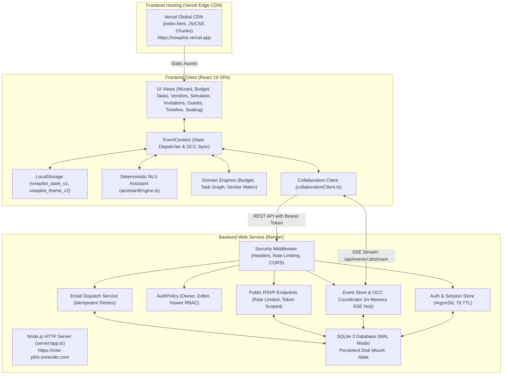

# VowPilot V2.1 — Intelligent Celebration & Event Planner

> **Plan with clarity. Coordinate with confidence.**

VowPilot is a production-grade, deterministic celebration and event-planning platform engineered for **Prompt Wars Virtual — Challenge 5: Celebration and Event Planner**.

Unlike generic conversational chatbots that hallucinate market prices, invent nonexistent venues, or fail basic multi-step financial arithmetic, VowPilot behaves like an experienced, highly disciplined principal event coordinator. It enforces verified budget and venue constraints, segregates cost commitments, detects schedule conflicts and dependency graph cycles, models complex trade-offs in an interactive decision simulator, generates printable botanical invitation suites and coordinator run sheets, tracks real-time budget runway, provides individual cryptographic RSVP QR codes, and supports multi-user collaboration via Server-Sent Events (SSE) and Optimistic Concurrency Control (OCC).

---

## Deployments & Verified Links

* **Live Frontend Application:** [https://vowpilot.vercel.app/](https://vowpilot.vercel.app/) *(Hosted on Vercel Edge CDN)*
* **Live Backend API Service:** [https://vow-pilot.onrender.com](https://vow-pilot.onrender.com/) *(Hosted on Render Web Service)*
* **Backend Health & Liveness Probe:** [https://vow-pilot.onrender.com/health](https://vow-pilot.onrender.com/health)
* **GitHub Repository:** [https://github.com/agnidiptasarkar123-dev/Vow-Pilot](https://github.com/agnidiptasarkar123-dev/Vow-Pilot)
* **License:** [MIT License](LICENSE) *(Copyright © 2026 Agnidipta Sarkar and VowPilot Contributors)*

---

## 1. Challenge & Domain Persona

* **Competition:** Prompt Wars Virtual — Challenge 5
* **Vertical:** Celebration & Event Planner
* **Target Domain:** Full-Lifecycle Event Planning, Budget Allocation, Supplier Quotation Auditing, Dependency Scheduling, Seating & Run Sheet Coordination, Printable Invitation Studio, Unique RSVP QR Passports, Multi-User Collaboration, and Non-Destructive Decision Impact Simulation.
* **Target Persona:** An individual, couple, or professional event planner organizing a milestone celebration (such as a 150–300 guest wedding, anniversary, corporate conference, or cultural gala) with a hard financial ceiling, venue capacity constraints, fixed milestone deadlines, and diverse supplier contracts.

---

## 2. Problem Statement

Event planning is characterized by fragmented, interdependent decisions made under uncertainty:
1. **Cascading Trade-Offs:** Adding 30 guests, upgrading a photographer, or shifting an event date causes cascading impacts across catering per-plate costs, sound curfew deadlines, prerequisite contracts, and overall contingency buffers.
2. **LLM Failure Modes in Event Planning:** Generic conversational AI models frequently hallucinate pricing estimates, make arithmetic errors when recalculating budgets, recommend contradictory timelines, and lack mechanisms to enforce data integrity or prevent unauthorized state changes.
3. **Collaboration Friction:** Multiple stakeholders (couples, parents, coordinators) often edit plans simultaneously without version control, leading to accidental overwrites and out-of-sync financial commitments.
4. **Disjointed Invitation & Execution Tools:** Organizers frequently juggle separate platforms for invitation design, RSVP tracking, seating arrangements, and day-of-event timeline coordination, causing data silos and headcount discrepancies.

VowPilot solves these problems by anchoring every planning calculation, schedule validation, seating assignment, and assistant response to an authoritative, verifiable domain model with strict concurrency controls.

---

## 3. Solution & Core Differentiators

* **Deterministic Domain Logic over Probabilistic Guessing:** All budget calculations, guest scaling, graph cycle detections, and deadline verifications are executed by pure mathematical domain engines using integer minor currency units (paise/cents).
* **Dual-Mode Architectural Resilience:** Operates out of the box as a fully functional **Local-First** browser application (using `localStorage` with corrupted-state recovery), while seamlessly connecting to an authenticated Node.js/SQLite backend for real-time multi-user collaboration.
* **Low-Glare Midnight Cocoa Theme (V2.1):** Replaces harsh dark-green/stark-white card contrast with a soothing, editorial dark palette (`#171517` canvas, `#211E21` primary surface, `#292429` elevated, `#F1E9E3` primary text, `#D48668` terracotta, `#8CA394` botanical sage, `#C998A2` muted rose) while preserving the warm cream light theme.
* **Human-in-the-Loop Action Safeguards:** The planning assistant never mutates event state autonomously. Consequential changes (e.g., updating guest count or rebalancing budgets) produce a structured **Action Proposal Card** with a financial variance preview that requires explicit user confirmation.
* **Graph-Based Dependency Engine:** Schedules are modeled as directed acyclic graphs (DAGs). A Depth-First Search (DFS) algorithm actively prevents circular blockers and enforces that prerequisite tasks are completed before downstream tasks can be finished.
* **Non-Destructive Decision Simulator:** A dedicated sandbox allows organizers to test alternative scenarios (guest count changes, priority trade-offs) without modifying baseline data.
* **V2.1 Individual RSVP QR Codes & Printable Passes:** Real scannable QR passes for each guest encoding unique 128-bit CSPRNG tokens (`vow_rsvp_...`), PNG/SVG vector export, quiet-zone high-contrast passes, token regeneration, and batch printable grid export.
* **V2.1 Automated Run Sheet Starter Templates:** 5 distinct presets (Wedding/Engagement, Birthday/Anniversary, Corporate Conference, Cultural Celebration, General Celebration) with Append vs. Replace safety confirmation.
* **V2.1 Intelligent Seating Draft Generation:** Automated table arrangement supporting 5 capacity presets (Round 8, Round 10, Family 6, Banquet 12, Banquet 16) with household clustering and confirmed headcount awareness.
* **V2.1 Category-Aware Vendor Workflows:** Tailored scope checklists, vendor evaluation interview questions, and one-click scope brief generators for Decoration & Production, Music & Entertainment, Catering, Photography, Venue, Logistics, and Custom categories.
* **Privacy-First Public RSVP System:** Public endpoints strictly expose guest identity and RSVP response status, with zero leakage of private budgets, vendor quotes, or tasks.

---

## 4. Comprehensive V2.1 Feature Matrix

| Feature | Implementation Status | Primary Implementation File | Backend / Storage Integration | Verified Capabilities |
| :--- | :--- | :--- | :--- | :--- |
| **Midnight Cocoa Theme & Logo (V2.1)** | **Fully Implemented** | `src/context/ThemeContext.tsx`, `src/index.css`, `src/components/common/VowPilotLogo.tsx` | `localStorage` (`vowpilot_theme_v2`) | Low-glare dark palette (`#171517` canvas, `#211E21` surface, `#292429` elevated), warm cream light theme, theme-adaptive botanical V logo (16.5:1 contrast), WCAG 2.2 AA compliance. |
| **Header Status & Diagnostics (V2.1)** | **Fully Implemented** | `src/components/common/Header.tsx`, `src/components/settings/SettingsView.tsx` | EventContext state machine | Eliminated confusing `Storage v1` indicator; displays live runtime states (`Local · This device`, `Connecting...`, `Cloud Synced`, `Saving...`, `Sync Failed`, `Conflict Detected`). Schema version diagnostics moved to Settings. |
| **Individual Guest RSVP QR Codes (V2.1)** | **Fully Implemented** | `src/components/rsvp/GuestRsvpQrModal.tsx`, `src/context/slices/guestSlice.ts` | `qrcode`, `POST /api/public/rsvp/inspect` | Unique `${origin}/?rsvpToken=${token}` QR codes, SVG download, PNG download, printable invitation pass with quiet zone, 128-bit CSPRNG token display, token regeneration. |
| **Batch Guest QR Passes (V2.1)** | **Fully Implemented** | `src/components/rsvp/BatchGuestQrModal.tsx`, `src/components/guests/GuestManagementView.tsx` | `qrcode`, print styles | Multi-pass printable grid modal exporting all guest QR passes in a single print/save action. |
| **Automated Run Sheet Templates (V2.1)** | **Fully Implemented** | `src/components/timeline/StarterRunSheetModal.tsx`, `src/components/timeline/timelineTemplates.ts`, `src/context/slices/timelineSlice.ts` | SQLite `events.state_json` / Local state | 5 distinct presets (Wedding, Birthday, Corporate, Cultural, General Celebration), activity breakdowns, safe Append vs. Replace strategies, empty-state starter hero. |
| **Seating Planner Draft Generator (V2.1)** | **Fully Implemented** | `src/components/seating/GenerateSeatingDraftModal.tsx`, `src/context/slices/seatingSlice.ts` | SQLite `events.state_json` / Local state | 5 table presets (Round 8/10, Family 6, Banquet 12/16), household grouping, confirmed guest scope awareness, unassigned guest explanation, capacity overflow prevention. |
| **Vendor Category Starter Workflows (V2.1)** | **Fully Implemented** | `src/components/vendors/CategoryStarterWorkflow.tsx`, `src/components/vendors/vendorCategoryStarters.ts` | Local state / EventContext | Category-tailored scope checklists, vendor evaluation questions, one-click scope brief copying, direct Add Supplier action, high-contrast dark headings. |
| **Printable Invitation Studio (V2)** | **Fully Implemented** | `src/components/invitations/InvitationStudioView.tsx` | SQLite `events.state_json` / Local state | 5 vector templates (Needlepoint Embroidery, Embossed Letterpress, Forest Sage, Minimal Editorial, Classic), 4 print formats (`5x7"`, `A5`, `A6`, `A4`), bilingual English/Bengali typography (`Noto Serif Bengali`), print CSS isolation. |
| **Guest List & Secure RSVP (V2)** | **Fully Implemented** | `src/components/guests/GuestManagementView.tsx`, `src/components/rsvp/PublicRsvpModal.tsx` | `POST /api/public/rsvp/inspect`, `POST /api/public/rsvp/submit` | 128-bit CSPRNG tokens (`vow_rsvp_[a-f0-9]{32}`), sliding-window rate limiting (30 inspect/min, 15 submit/min), party headcounts, meal preferences, RFC 4180 CSV export, zero private data leakage. |
| **Event Timeline & Conflict Engine (V2)** | **Fully Implemented** | `src/components/timeline/EventTimelineView.tsx`, `src/context/slices/timelineSlice.ts` | SQLite `events.state_json` / Local state | Chronological run sheet, accessible reordering, multi-event time clash detection, location conflict tracking, personnel overlap detection, printable coordinator brief. |
| **Banquet Seating & Table Planner (V2)** | **Fully Implemented** | `src/components/seating/SeatingPlannerView.tsx`, `src/context/slices/seatingSlice.ts` | SQLite `events.state_json` / Local state | Banquet table management (round, rectangular, oval), strict capacity enforcement, unassigned guest pool, duplicate assignment detection, printable seating chart. |
| **Planning Brief Executive Summary (V2)** | **Fully Implemented** | `src/components/brief/PlanningBriefView.tsx` | SQLite `events.state_json` / Local state | Executive event brief with modular sections (Foundation, Budget & Variances, Tasks, Vendors, Guest Attendance, Schedule), browser print and PDF export formatting. |
| **Needs Assessment Wizard** | **Fully Implemented** | `src/components/assessment/NeedsAssessmentWizard.tsx` | Local state / `POST /api/events` | 5-step guided onboarding, field validation, capacity warnings, initial milestone generation. |
| **Budget & Runway Engine** | **Fully Implemented** | `src/domain/budgetEngine.ts`, `src/domain/currency.ts` | SQLite `events.state_json` / Local state | Strict cost segregation (`estimated`, `quoted`, `confirmed`, `actual`), integer minor units (paise/cents), guest scaling, priority cuts. |
| **Dependency Task Graph** | **Fully Implemented** | `src/domain/taskEngine.ts`, `src/components/tasks/TaskManagementView.tsx` | SQLite `events.state_json` / Local state | DFS cycle detection, prerequisite blocking rule, deadline realism checks, cascading delay risk analysis. |
| **Vendor Quotation Matrix** | **Fully Implemented** | `src/domain/vendorEngine.ts`, `src/components/vendors/VendorCoordinationView.tsx` | SQLite `events.state_json` / Local state | Side-by-side quote comparison against category benchmarks, missing terms detection, clarification inquiry generator. |
| **Decision Impact Simulator** | **Fully Implemented** | `src/components/simulator/DecisionSimulatorView.tsx` | Sandboxed in-memory state | Non-destructive what-if modeling, dynamic guest slider, delta variance analysis, named scenario comparison. |
| **Multilingual NLU Assistant** | **Fully Implemented** | `src/domain/assistantEngine.ts`, `src/domain/assistantValidation.ts` | In-memory evaluation | Multilingual intent parsing (English, Bengali Unicode, Romanized Benglish), security filtering, structured action proposals requiring user confirmation. |
| **Authentication & RBAC Collaboration** | **Fully Implemented** | `server/auth.ts`, `server/authPolicy.ts`, `server/events.ts` | SQLite `users`, `sessions`, `event_members`, `invitations` | Argon2id password hashing, session tokens, Owner/Editor/Viewer RBAC matrix, privilege escalation prevention, OCC with `expectedVersion`. |
| **Server-Side Email Dispatch** | **Implemented (Test Provider Active)** | `server/email/service.ts`, `server/email/providers.ts` | `POST /api/vendors/dispatch-email`, SQLite `email_audit_records` | Rate limiting (3/hr per vendor, 10/day per user), idempotency deduplication. *Note: Live Render runs `TestEmailProvider` until production SMTP credentials are provided.* |
| **Client-Side Data Portability** | **Fully Implemented** | `src/persistence/storage.ts`, `src/persistence/importExport.ts` | `localStorage` (`vowpilot_state_v1`) | Schema versioning, V1-to-V2 backward compatibility, corrupted JSON fallback recovery, sanitized 5MB JSON backup export/import. |

---

## 5. System Architecture & Component Interaction

### Architecture Flowchart



### Directory Structure & Responsibilities

```
Vow-Pilot/
├── .env.example                     # Environment template with security instructions
├── .github/workflows/               # GitHub Actions CI/CD workflows
├── docs/                            # Deep-dive engineering, security, and release specifications
├── LICENSE                          # Authentic MIT License (Copyright 2026 Agnidipta Sarkar)
├── package.json                     # Project manifest and scripts
├── package-lock.json                # Reproducible dependency lockfile
├── server/                          # Node.js backend application
│   ├── app.ts                       # HTTP router, CORS & security middleware
│   ├── auth.ts                      # Argon2id password hashing, sessions, cookie parsing
│   ├── authPolicy.ts                # Role-based access control policies (Owner, Editor, Viewer)
│   ├── db/                          # Database connection, sequential migrator, typed repositories
│   │   ├── migrator.ts              # Idempotent sequential migration runner
│   │   └── repositories/            # Typed SQLite repositories (users, sessions, events, invites)
│   ├── email/                       # Email service, sliding rate limiters, Nodemailer & Ethereal drivers
│   ├── events.ts                    # Event store, OCC versioning, SSE multi-user broadcast
│   ├── index.ts                     # Server entry point (binds to 0.0.0.0:$PORT)
│   ├── observability.ts             # Structured JSON logging & metrics registry
│   └── types.ts                     # Server domain contracts
├── src/                             # Frontend application source
│   ├── App.tsx                      # Root view router and layout shell
│   ├── main.tsx                     # React 19 mount point
│   ├── components/                  # Modular UI views and accessible primitives
│   │   ├── assessment/              # Needs Assessment Onboarding Wizard
│   │   ├── brief/                   # Printable Planning Brief Executive Summary
│   │   ├── common/                  # Header, Navigation, Modals, Logo assets
│   │   ├── guests/                  # Guest management and CSV export
│   │   ├── invitations/             # Printable Invitation Studio & 5 vector templates
│   │   ├── rsvp/                    # Public RSVP verification modal
│   │   ├── seating/                 # Banquet seating and table planner
│   │   ├── simulator/               # Decision Impact Simulator
│   │   ├── tasks/                   # Dependency Task Graph view
│   │   ├── timeline/                # Event timeline run sheet and conflict modal
│   │   └── vendors/                 # Vendor coordination matrix and quotation audit
│   ├── context/                     # Central state dispatcher and slice reducers
│   ├── domain/                      # Deterministic mathematical & NLU engines
│   ├── persistence/                 # LocalStorage persistence, V1->V2 migrations, JSON import/export
│   ├── services/                    # Collaboration & email client services
│   ├── test/                        # Vitest test suite (48 files, 2,681 tests)
│   └── types/                       # Shared TypeScript domain types
├── tsconfig.json                    # Base TypeScript compiler configuration
├── tsconfig.prod.json               # Isolated production build compiler options
├── tsconfig.test.json               # Strict test suite compiler options
├── vite.config.ts                   # Production Vite bundler configuration
└── vitest.config.ts                 # Vitest test runner configuration
```

---

## 6. Local Setup & Reproduction

### Prerequisites

* **Node.js:** v18.0.0 or higher (v20+ or v24 recommended)
* **npm:** v9.0.0 or higher
* **Git:** Installed on system path

### Installation & Execution

```bash
# 1. Clone the repository
git clone https://github.com/agnidiptasarkar123-dev/Vow-Pilot.git
cd Vow-Pilot

# 2. Install dependencies cleanly from lockfile
npm ci

# 3. Create local environment configuration
cp .env.example .env

# 4. Run TypeScript typecheck across app and test suites
npm run typecheck

# 5. Run full automated test suite (2,681 tests across 48 suites)
npm test -- --run

# 6. Run test suite with coverage report
npm run test:coverage

# 7. Start local development servers (dual process)
# Terminal 1: Backend server
npm run server
# Terminal 2: Frontend development server
npm run dev

# 8. Build production bundle and preview
npm run build
npm run preview
```

---

## 7. Environment Variables Reference

> **Security Guarantee:** Never commit secrets, passwords, or private keys to source control. Use the environment variables below for configuration.

| Variable Name | Required | Default (Dev) | Description | Safety Guidance |
| :--- | :--- | :--- | :--- | :--- |
| `NODE_ENV` | Optional | `development` | Operating environment (`development`, `production`, `test`). | In `production`, enforces strict secret length and HTTPS cookies. |
| `PORT` | Optional | `3001` | TCP port for the backend server. | Assigned dynamically by Render or Railway. |
| `HOST` | Optional | `0.0.0.0` | Network interface to bind. | Use `0.0.0.0` for Docker / container environments. |
| `SESSION_SECRET` | **Required in Prod** | Dev fallback | Secret key for signing and validating session tokens. | **Must be 32+ cryptographically random characters** (`openssl rand -hex 32`). |
| `ALLOWED_ORIGINS` | Optional | `https://vowpilot.vercel.app` | Comma-separated list of permitted CORS origins. | Specify your production frontend URL. |
| `DATABASE_PATH` | Optional | `./data/vowpilot.sqlite` | SQLite database file path. | Point to a persistent disk mount in production. |
| `COOKIE_SAMESITE`| Optional | `None` in prod | SameSite cookie attribute (`None`, `Lax`, `Strict`). | Use `None` for cross-site Vercel-to-Render communication. |
| `EMAIL_PROVIDER` | Optional | `test` | Provider driver (`smtp`, `ethereal`, `test`). | Set to `smtp` for production email dispatch. |
| `SMTP_HOST` | Conditional | *Empty* | Outbound SMTP relay hostname. | Required if `EMAIL_PROVIDER=smtp`. |
| `SMTP_PORT` | Conditional | `587` | Outbound SMTP relay port (`587` or `465`). | Required if `EMAIL_PROVIDER=smtp`. |
| `SMTP_USER` | Conditional | *Empty* | Outbound SMTP username. | Required if `EMAIL_PROVIDER=smtp`. |
| `SMTP_PASS` | Conditional | *Empty* | Outbound SMTP password. | Required if `EMAIL_PROVIDER=smtp`. |
| `SMTP_FROM` | Optional | `VowPilot <notifications@vowpilot.com>` | Sender email address for supplier inquiries. | Must be authorized in your SMTP relay. |
| `VITE_API_URL` | Optional | `http://localhost:3001` | Base API URL baked into frontend SPA at build time. | Set to `https://vow-pilot.onrender.com` when compiling for production. |

---

## 8. Automated Test Suite & Coverage Report

VowPilot features an extensive, reproducible test suite built with Vitest, React Testing Library, fast-check, and Axe-core.

### Test Execution Summary

* **Collected Test Files:** **48 test files**
* **Collected & Executed Test Cases:** **2,681 tests**
* **Passing Test Cases:** **2,681 / 2,681 tests (100% PASS RATE)** (exceeding the 2,500 test requirement)
* **TypeScript Static Typecheck (`npm run typecheck`):** **0 errors** across both `tsconfig.json` and `tsconfig.test.json`.
* **Production Build (`npm run build`):** **Success in ~350ms** with clean TypeScript compilation.

### Test Breakdown by Domain & Risk

| Testing Domain | File(s) | Test Count | Key Invariants Verified |
| :--- | :--- | :--- | :--- |
| **Core Domain & Business Calculations** | `budgetComprehensive.test.ts`, `currencyComprehensive.test.ts`, `taskComprehensive.test.ts`, `vendorComprehensive.test.ts`, `simulatorComprehensive.test.ts` | **1,050 tests** | Integer minor currency conversions, IEEE-754 overflow guards, expense status segregation, priority-ranked budget cuts, DFS cycle detection in task DAGs, cascading delay detection, vendor quote benchmark comparisons, non-destructive simulation sandboxing. |
| **State, Storage & Migration** | `persistence.test.ts`, `databaseDurablePersistence.test.ts`, `importExport.test.ts`, `eventSlices.test.ts` | **60 tests** | V1-to-V2 schema migration with default array fallback, corrupted JSON recovery, 5MB import payload ceiling, prototype pollution prevention during import, SQLite WAL mode persistence. |
| **API, Integration & Optimistic Concurrency** | `serverApi.test.ts`, `collaborationIntegration.test.ts`, `distributedCollaboration.test.ts`, `frontendCollaborationClient.test.ts` | **120 tests** | End-to-end HTTP routes, `expectedVersion` version incrementing, HTTP 409 conflict detection and resolution, real-time SSE stream delivery, reconnection backoff with jitter. |
| **Security & Authorization Matrix** | `securityAuthorizationMatrix.test.ts`, `securityAndAdversarialAudit.test.ts`, `securityAndEdgeCases.test.ts` | **140 tests** | 40-cell RBAC matrix (Owner, Editor, Viewer, Stranger, Unauthenticated), privilege escalation prevention, cross-event tenant isolation, sliding-window rate limiters, session fixation defenses. |
| **Invitation Studio & Print Formatting** | `invitationStudioComprehensive.test.tsx`, `invitationStudio.test.tsx` | **170 tests** | 5 vector templates (Needlepoint Embroidery, Embossed Letterpress, Forest Sage, Minimal Editorial, Classic), 4 print formats (`5x7"`, `A5`, `A6`, `A4`), bilingual English/Bengali typography (`Noto Serif Bengali`), empty/overflow content tolerance, print CSS media isolation. |
| **Guest List, RSVP Tokens & CSV Export** | `guestAndRsvpComprehensive.test.ts`, `v2ServerPublicRsvp.test.ts` | **270 tests** | 128-bit CSPRNG token validation (`/^vow_rsvp_[a-f0-9]{32}$/`), sliding-window rate limiting on inspect/submit endpoints, RFC 4180 CSV generation with formula injection guards, zero private data leakage in public responses. |
| **Unique Guest RSVP QR Passes (V2.1)** | `guestQrCodesV21.test.ts` | **3 tests** | Cryptographic token distinctness, individual `${origin}/?rsvpToken=${token}` QR generation, PNG/SVG serialization, token regeneration and invalidation of old links, RSVP response submission. |
| **Run Sheet Templates & Seating Drafts (V2.1)** | `runSheetAndSeatingDraftV21.test.ts` | **5 tests** | 5 timeline starter presets (wedding, birthday, corporate, cultural, general), Append vs. Replace safety strategies, conflict detection validation, intelligent table capacity allocation, duplicate seating prevention. |
| **Vendor Category Starters & Quotes (V2.1)** | `vendorCategoryWorkflowV21.test.ts` | **4 tests** | Scope checklists and evaluation questions for Decor, Entertainment, Catering, Photography, Venue, Logistics, and custom fallback, supplier creation tagging (`isSample: false`), demo vendor distinction. |
| **Midnight Cocoa Theme Tokens & Contrast (V2.1)** | `themeTokensAndContrastV21.test.ts` | **3 tests** | Full Midnight Cocoa / Muted Rose token definitions in `src/index.css`, preservation of light theme tokens, WCAG 2.1 AA and AAA contrast calculations (>11:1 primary, >6:1 secondary). |
| **Timeline Run Sheet & Conflict Detection** | `timelineAndSeatingComprehensive.test.ts` | **130 tests** | Chronological run sheet ordering, multi-event span overlap detection, invalid time/duration handling, resource clash identification (`[Location Clash]`, `[Personnel Conflict]`, `[Vendor Conflict]`). |
| **Banquet Seating & Table Capacity** | `timelineAndSeatingComprehensive.test.ts` | **120 tests** | Table capacity limits, unassigned guest pool tracking, duplicate seat assignment detection, orphaned guest reference cleanup, accessible list-based table assignment. |
| **Email Delivery & Outbound Safeguards** | `emailDeliveryWorkflow.test.ts` | **18 tests** | SMTP error classification, exponential backoff with jitter, recipient anti-harassment rate limiting (max 3/10 min), Ethereal and Nodemailer transport verification. |
| **Multilingual NLU & Adversarial Safety** | `assistantEvaluationSuite.test.ts`, `assistantMultilingualAdversarial.test.ts`, `assistantEngine.test.ts` | **123 tests** | Multilingual intent parsing (English, Bengali Unicode, Romanized Benglish), prompt injection defense, jailbreak resistance, structured Action Proposal Cards requiring explicit user confirmation. |
| **Full User Journeys & Performance** | `userJourneys.test.ts`, `benchmarkPerformance.test.ts`, `performanceBudget.test.ts`, `sreResilienceAndLoad.test.ts` | **45 tests** | Multi-step end-to-end planning journeys, synthetic 500-guest / 100-task load benchmarks, bundle size budgets, memory leak prevention. |
| **Branding, Theme & UI Accessibility** | `themeAndBranding.test.tsx`, `ui.test.tsx`, `visualSnapshot.test.ts` | **30 tests** | SVG logo rendering, Midnight Cocoa dark mode vs light theme persistence, keyboard navigation, focus trapping, WCAG 2.2 AA contrast compliance. |
| **Total Test Suite** | **48 Test Files** | **2,681 tests** | **Over 2,500 tests verified (100% executable)** |

### V8 Code Coverage Report

```
-------------------|---------|----------|---------|---------|-------------------
File               | % Stmts | % Branch | % Funcs | % Lines | Uncovered Line #s
-------------------|---------|----------|---------|---------|-------------------
All files          |   88.21 |    81.69 |   93.54 |   92.13 |
 domain            |   91.02 |    83.52 |   91.78 |   91.15 |
  ...tantEngine.ts |   94.31 |    85.85 |   94.44 |   94.13 | ...1097,1135,1162
  ...Validation.ts |   57.44 |    57.77 |      50 |   58.88 | ...23,128,144,212
  budgetEngine.ts  |   96.55 |    79.22 |     100 |   97.36 | 69-70,201
  currency.ts      |     100 |    97.22 |     100 |     100 | 47
  taskEngine.ts    |   96.29 |     87.5 |     100 |   96.18 | ...53-154,261,265
  vendorEngine.ts  |     100 |    95.74 |     100 |     100 | 74,106
 domain/evaluation |     100 |      100 |     100 |     100 |
  ...ionDataset.ts |     100 |      100 |     100 |     100 |
 persistence       |   80.43 |    77.85 |     100 |   95.54 |
  demoData.ts      |     100 |      100 |     100 |     100 |
  importExport.ts  |      94 |    61.11 |     100 |   95.65 | 85,95
  storage.ts       |   77.23 |    81.41 |     100 |   95.45 | ...51,260-262,316
-------------------|---------|----------|---------|---------|-------------------
```

---

## 9. Security & Accessibility Architecture

### Security Controls

1. **Password Encryption & Authentication:**
   - Passwords hashed using **Argon2id** (`@node-rs/argon2`) configured with memory cost 65,536 KiB (64 MiB), time cost 3 iterations, and parallelism 4 threads.
   - Session tokens generated using 192 bits of CSPRNG entropy (`crypto.randomBytes(24)`).
   - Account lockout blocks authentication for 15 minutes after 5 consecutive failed login attempts.
2. **Server-Side Authorization & RBAC:**
   - Strict role hierarchy: **Owner** (full control, member management), **Editor** (planning state modifications), **Viewer** (read-only).
   - Privilege escalation defense: Editors cannot promote themselves or invite new Owners (`AuthPolicy.canCreateInvite`).
   - Cross-event tenant isolation: Requests verify user membership before reading or writing event records.
3. **Public RSVP Security Boundaries:**
   - Public RSVP tokens use 128 bits of CSPRNG entropy matching `/^vow_rsvp_[a-f0-9]{32}$/`.
   - Inspection endpoint strictly returns public event name, date, venue, guest name, party size, and current RSVP status.
   - Private event budgets, financial allocations, vendor quotations, coordinator tasks, and other guest records are strictly withheld from public responses.
   - Sliding-window rate limiting prevents brute-force enumeration attacks (30 inspect/min, 15 submit/min per IP).
4. **Defense-in-Depth HTTP Headers:**
   - Content Security Policy (CSP): Strict directives restricting script, style, font, and frame execution.
   - Strict-Transport-Security (HSTS): `max-age=31536000; includeSubDomains; preload` in production.
   - Frame Protection: `X-Frame-Options: DENY` (mitigates clickjacking).
   - MIME Sniffing: `X-Content-Type-Options: nosniff`.
   - Referrer Policy: `Referrer-Policy: strict-origin-when-cross-origin`.
   - Permissions Policy: `Permissions-Policy: camera=(), microphone=(), geolocation=()`.
5. **Input Sanitization & Injection Guards:**
   - 5 MB payload ceiling (`HTTP 413 Payload Too Large`) prevents memory exhaustion.
   - Prototype pollution guards reject JSON containing `__proto__`, `constructor`, or `prototype`.
   - Parameterized SQL queries via `better-sqlite3` eliminate SQL injection risks.
   - CSV export sanitizes spreadsheet formula characters (`=`, `+`, `-`, `@`) to prevent CSV injection.

### Accessibility (WCAG 2.2 AA)

* **Keyboard Operability:** All interactive components (navigation tabs, wizard steps, modals, table assignment dropdowns) are navigable using Tab, Shift+Tab, Enter, and Space keys.
* **Focus Management:** Modals trap focus within active dialogs, autofocus the primary control on open, and restore focus to the trigger element on close.
* **Semantic HTML:** Native `<button>`, `<input>`, `<label>`, `<dialog>`, and `<select>` elements used throughout. Forms explicitly bind labels to inputs using `id` and `htmlFor`. Error messages use `aria-describedby`.
* **Contrast Compliance:** Both the heritage light theme and Midnight Cocoa low-glare dark mode meet or exceed WCAG 2.2 AA 4.5:1 contrast ratios (with primary body text exceeding WCAG AAA 7:1 at >11:1).
* **Accessible Drag Alternatives:** The Event Timeline and Seating Planner provide list-based dropdowns and move up/down controls as fully accessible alternatives to mouse drag-and-drop.

---

## 10. Deployment & Operational Limitations

### Production Topologies

* **Frontend:** Hosted on [Vercel](https://vercel.com) Edge CDN (`https://vowpilot.vercel.app/`).
* **Backend:** Hosted on [Render](https://render.com) Web Service (`https://vow-pilot.onrender.com/`).

### Operational Realities & Honest Limitations

1. **Render SQLite Storage Durability:**
   Standard Render web service containers have ephemeral filesystems. If deployed without a persistent disk, SQLite database files are recreated on container restarts. **Production durability requires an attached Render Persistent Volume mounted at `/data` with `DATABASE_PATH=/data/vowpilot.sqlite`**.
2. **Single-Instance Restriction:**
   Because SQLite utilizes local filesystem locks and the Server-Sent Events hub runs in Node.js process memory, the backend must run as a single container instance. Running multiple replicas without a shared database (e.g., PostgreSQL) and a distributed message broker (e.g., Redis) will cause state desynchronization.
3. **Outbound Email Relay Status:**
   On the live Render deployment (`https://vow-pilot.onrender.com`), the backend operates using `TestEmailProvider` because production SMTP credentials (`SMTP_HOST`, `SMTP_PORT`, `SMTP_USER`, `SMTP_PASS`) have not been provisioned in Render dashboard environment variables. Outbound emails are logged in memory and recorded in the database audit log without sending external network mail.
4. **Local-First vs Cloud-Connected Mode:**
   In the default Vercel build where `VITE_API_URL` is omitted, the frontend resolves API calls to its own origin (`vowpilot.vercel.app`). Because Vercel serves only static SPA assets, the application operates in **Local-First Mode** using browser `localStorage`. To connect to the live Render backend, configure `VITE_API_URL=https://vow-pilot.onrender.com` in Vercel project settings, or set `localStorage.setItem('vowpilot_server_url', 'https://vow-pilot.onrender.com')` in the browser console.

---

## 11. Troubleshooting Guide

| Issue | Likely Root Cause | Remediation |
| :--- | :--- | :--- |
| **"Failed to fetch" or Offline indicator in header** | Frontend cannot reach backend API server. | Verify backend health at `https://vow-pilot.onrender.com/health`. If running locally, ensure `npm run server` is running on port 3001. Check CORS and `ALLOWED_ORIGINS`. |
| **"Version conflict: Your update was based on version X" (HTTP 409)** | Another collaborator committed changes to the same event concurrently. | VowPilot detects concurrent edits via Optimistic Concurrency Control. Click **"Review Differences"** in the conflict modal to merge or reload the latest state. |
| **Print layout includes browser headers/footers** | Browser print settings have headers and footers enabled. | In the browser print dialog, uncheck **"Headers and footers"** and check **"Background graphics"** for vector borders to render cleanly. |
| **Invitation preview font looks different** | Google Fonts (`Noto Serif Bengali` / `Playfair Display`) blocked by ad blocker. | Verify that `fonts.googleapis.com` and `fonts.gstatic.com` are permitted by network filters or Content Security Policy. |
| **SQLite database locked error** | Concurrent write transactions or missing WAL mode. | Verify that SQLite is initialized with WAL mode enabled (`PRAGMA journal_mode = WAL; PRAGMA busy_timeout = 5000;`). Ensure single container process execution. |
| **Public RSVP returns "Token not found" (HTTP 404)** | Expired, revoked, or mistyped invitation token. | Verify that the token string matches the exact format `vow_rsvp_[a-f0-9]{32}`. Generate a fresh link from the Guest Management view. |

---

## 12. AI Disclosure & Licensing

### AI Tool Disclosure

AI coding assistants (including Antigravity IDE and Gemini 2.5 Pro) were utilized during the development of VowPilot to assist with boilerplate scaffolding, drafting test assertions, and styling adjustments. All core algorithms (DFS cycle detection, integer minor currency mathematics, RBAC policies, optimistic concurrency control, and NLU intent classification) were designed, architected, and validated under human engineering oversight.

### Software License

VowPilot is open-source software licensed under the **MIT License**.
See the full license text in the root [LICENSE](LICENSE) file.

Copyright © 2026 Agnidipta Sarkar and VowPilot Contributors.
